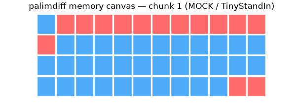
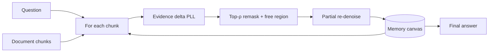

# palimdiff

[](https://github.com/Sebastianrodaaa/palimdiff/actions/workflows/ci.yml)
[](LICENSE)
[](https://www.python.org/downloads/)

**In-place memory editing for long-horizon agents with masked diffusion LMs — evidence-delta remasking instead of full memory rewrites.**

Long-horizon memory agents (e.g. [MemAgent](https://arxiv.org/abs/2507.02259)) keep a fixed-size text memory and rewrite **all** of it after every chunk. **palimdiff** keeps a **memory canvas**, scores each token by **evidence delta** (PLL drop when the denoiser sees the new chunk vs. the previous one), **remasks** only high-impact spans (+ a small free region), and **re-denoises** just those positions.

<p align="center">
  
  <br/>
  <em>MOCK demo GIF — TinyStandIn on CPU, not LLaDA/Dream. Regenerate: <code>make demo</code>.</em>
</p>

## How it works



| Step | What happens |
|------|----------------|
| 1 | Estimate per-token PLL with **K** random mask partitions under **old** vs **new** chunk conditioning. |
| 2 | **Evidence delta** = PLL(new) − PLL(old); remask most negative tokens (fraction **ρ**) plus reserved free slots. |
| 3 | Run masked diffusion **only** on remasked positions; kept tokens stay fixed. |

See [docs/RELATED_WORK.md](docs/RELATED_WORK.md) and [docs/REPORT.md](docs/REPORT.md).

## Install

```bash
git clone https://github.com/Sebastianrodaaa/palimdiff.git
cd palimdiff
pip install -e ".[dev]"
```

GPU denoisers (LLaDA-8B-Instruct, Dream-v0-Instruct-7B) require separate `torch` / `transformers` installs and Hugging Face access — check each **model card license** before use.

## Quickstart (CPU smoke, MOCK)

```bash
make build-data    # fixed seed 42 — synthetic RULER-HQA + retention probe (MOCK)
make test          # pytest including end-to-end MOCK fixture
make demo          # writes docs/assets/demo_mock.gif (MOCK)
python scripts/run_experiments.py --denoiser tiny --seed 42
```

Full pipeline:

```bash
make repro
```

## Project layout

```
palimdiff/
  canvas.py           # fixed-length memory + span bookkeeping
  evidence_delta.py   # PLL delta scoring + remask selection
  remask_denoise.py   # partial denoise step
  agent_loop.py       # chunk loop
  denoisers/          # tiny (CPU), llada, dream interfaces
baselines/            # ar_overwrite, full_overwrite, append_truncate, confidence, random
scripts/              # dataset builders, experiments, demo GIF
tests/mock_data/      # MOCK fixtures
```

## Results

**GPU benchmark numbers (RULER-HQA accuracy, retention probe, 3 seeds): pending.**

After `make repro` on CPU, a **tiny-stand-in** summary is written to `results/cpu_tiny_seed42.json`. README tables must come from JSON only:

```bash
python scripts/generate_readme_results.py
```

<!-- AUTO-GENERATED from `results/cpu_tiny_seed42.json` -->

| Arm | Mean denoised tokens (retention subset) | Note |
|-----|----------------------------------------|------|
| `append_truncate` | 0.0 | from real tiny-stand-in run |
| `ar_overwrite` | 448.0 | from real tiny-stand-in run |
| `confidence` | 133.0 | from real tiny-stand-in run |
| `evidence_delta` | 133.0 | from real tiny-stand-in run |
| `full_overwrite` | 448.0 | from real tiny-stand-in run |
| `random` | 133.0 | from real tiny-stand-in run |

_Source: `cpu_tiny_seed42.json`, denoiser=`tiny`, `mock_eval: true` — **not** GPU benchmark QA accuracy._

| Status | Description |
|--------|-------------|
| CPU tiny runs | Real code path; token counts only |
| LLaDA / Dream @ 8K–128K | **Pending** — use commands in [docs/REPORT.md](docs/REPORT.md) |

## Reproduce (GPU, when available)

```bash
make build-data
python scripts/build_ruler_hqa.py --use-hotpot --out data/ruler_hqa/hotpot.jsonl  # if datasets installed
python scripts/run_experiments.py --denoiser llada --seed 42 --rho 0.25
python scripts/run_experiments.py --denoiser dream --seed 42 --rho 0.25
# Repeat seeds: 43, 44
```

## Citation

```bibtex
@software{palimdiff2026,
  title  = {palimdiff: In-place memory editing for long-horizon agents with diffusion LMs},
  year   = {2026},
  url    = {https://github.com/Sebastianrodaaa/palimdiff}
}
```

## License

MIT — see [LICENSE](LICENSE). Third-party **models** and **datasets** retain their original licenses.
